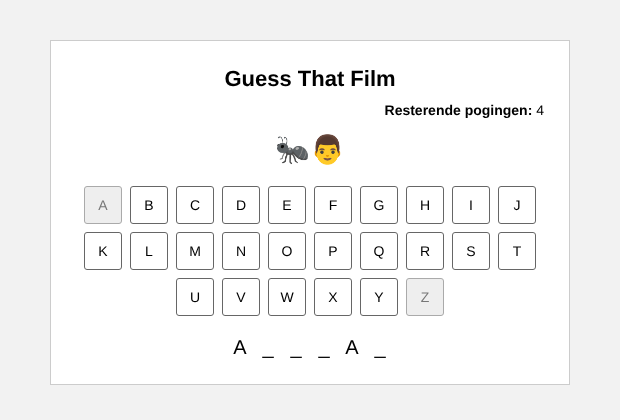

# Guess That Film

Een raadspel in de browser: je krijgt een paar emoji's en moet raden welke film het is door letters te kiezen, net als bij galgje. Je mag 5 keer een verkeerde letter kiezen.

Gemaakt in mijn eerste jaar Software Developer aan het Grafisch Lyceum Rotterdam.

**Live demo:** https://guessthatfilm.netlify.app



## Hoe het werkt

- De films staan in een JavaScript-object: de emoji's zijn de sleutel, de titel is de waarde.
- Bij elk nieuw spel kiest het script een willekeurige film, maar nooit twee keer achter elkaar dezelfde.
- Voor elke letter van de titel komt een streepje in beeld. Spaties worden meteen ingevuld.
- De letterknoppen A tot en met Z worden met JavaScript gemaakt. Kies je een goede letter, dan verschijnt die op elke plek waar hij in de titel voorkomt. Kies je een verkeerde, dan gaat er een poging af.
- Heb je alle letters, dan win je. Zijn je pogingen op, dan is het game over. In beide gevallen zie je welke film het was.

## Gebruikte technieken

- HTML
- CSS (flexbox)
- JavaScript (objecten, arrays, `Math.random()`, DOM-elementen maken met `createElement`, event listeners)

## Wat ik heb geleerd

- Elementen zoals knoppen met JavaScript aanmaken in plaats van ze in de HTML te zetten
- Met een object en `Object.keys()` werken om willekeurige items te kiezen
- Bijhouden hoe het spel ervoor staat met variabelen (aantal goede letters, aantal pogingen)
- Knoppen uitschakelen met `disabled` als ze al gebruikt zijn of als het spel voorbij is

## Zelf uitproberen

Download de bestanden en open `index.html` in je browser. Er hoeft niets geïnstalleerd te worden.

## Films toevoegen

Voeg in `script.js` een regel toe aan `moviesObject`, bijvoorbeeld:

```javascript
"🦁👑": "The Lion King",
```

Gebruik in de titel alleen letters en spaties, want het toetsenbord heeft alleen A tot en met Z.
# guessthatfilm
